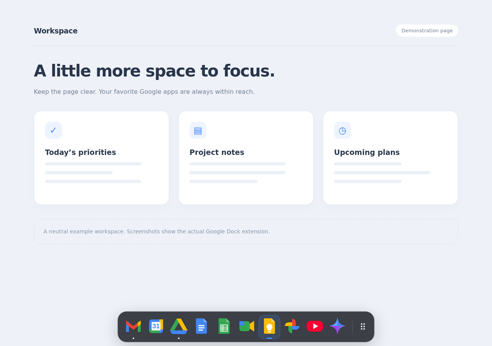
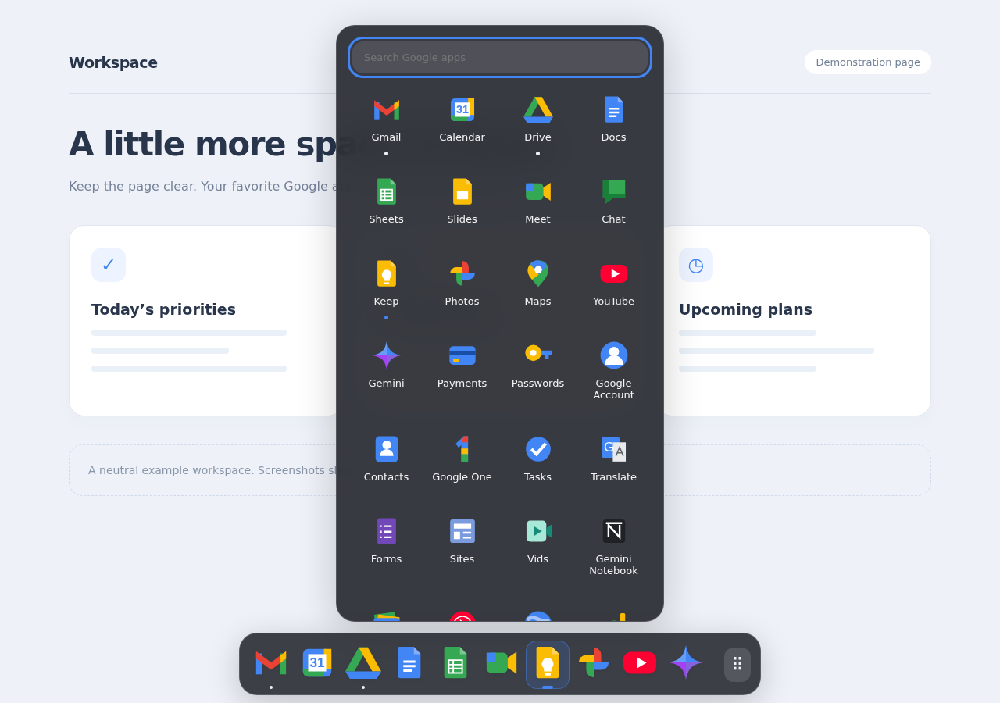
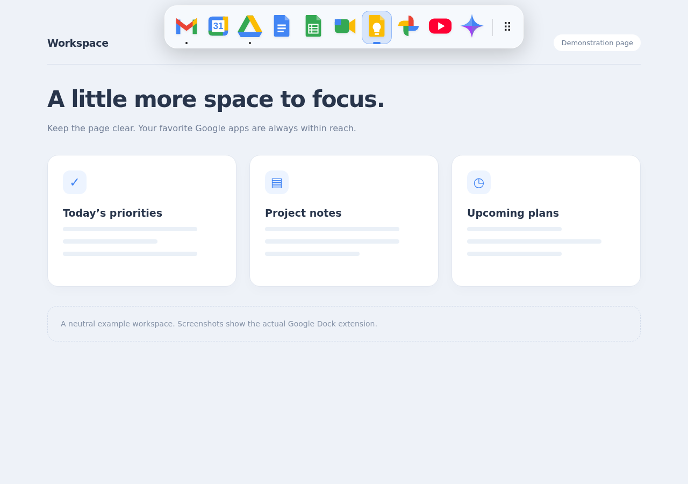
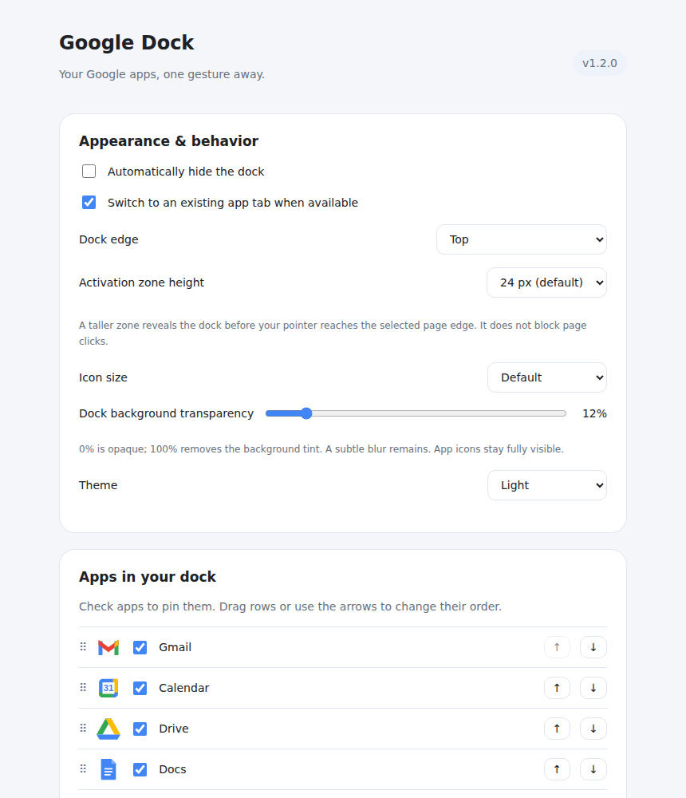

# Google Dock for Chrome

Keep your Google apps one click away — in a floating dock or a toolbar launcher for your pinned apps.

## Screenshots

**Bottom dock**

**App menu with running-app indicators**

**Top dock**

**Settings**

## Install

1. Download the **release ZIP** from the [latest release](https://github.com/lophas/google-dock-for-chrome/releases/latest) and extract it.
2. Open `chrome://extensions` and enable **Developer mode**.
3. Click **Load unpacked** and select the extracted folder containing `manifest.json`.
4. Refresh your open website tabs and pin **Google Dock** to Chrome’s toolbar.

To update, replace the extension files, click **Reload** and refresh your website tabs. Your settings are preserved.

## Quick start

- Move the pointer to the **bottom center** of a webpage to reveal the dock.
- Click an app to open it or return to its existing tab.
- Click the **grid button** to search all apps. The toolbar launcher shows **only your pinned apps**, in exactly the same order as the dock, plus **Settings**. Add other apps using the dock app menu or Settings.
- Right-click an icon and choose **Keep in Dock** to add or remove a favorite.
- Drag your pinned icons to put them in your preferred order.

Open **Settings** from the app menu or toolbar launcher to choose how you want to use it:

| Dock edge | Experience |
| --- | --- |
| **Bottom** | Reveal the dock at the bottom of the page |
| **Top** | Reveal the dock at the top of the page |
| **Disabled — toolbar only** | Hide the webpage dock and access apps from the toolbar |

## Features

- **Persistent app tabs:** switch to the app you already have open, without creating duplicates.
- **Clear activity indicators:** a dot shows running apps in the dock and app menu; blue marks the active app.
- **Favorites and running apps:** keep selected icons pinned; other open apps appear to their right.
- **Organized tabs:** app tabs join a **Google Dock** group and follow your icon order.
- **Shared experience:** your favorites and app-menu state follow you across tabs. Opening an app dismisses the menu.
- **Custom appearance:** choose icon size, light/dark/system theme, background transparency and autohide. The dock has a subtle 4 px blur.
- **Flexible activation:** adjust the trigger-zone height. A taller zone can help avoid conflict with the macOS Dock.
- **Backup & restore:** save your pinned apps and their order to a JSON file, then restore them when needed.
- **Different accounts per app:** remember a preferred signed-in Google account for Photos or another app.

## Controls

| Action | Result |
| --- | --- |
| Click an app | Open it or activate its existing tab |
| Ctrl/Cmd/Shift-click | Open a new tab |
| Middle-click | Open a background tab |
| Right-click → **Open / Close** | Open the app or close one of its tabs |
| **Alt+Shift+G** | Toggle the dock; in Disabled mode, open the toolbar launcher |
| **Escape** | Dismiss the context menu or dock |

Customize the keyboard shortcut at `chrome://extensions/shortcuts`.

## Apps & shortcuts

Choose from 32 apps and shortcuts in the searchable app menu. Right-click any app to keep it in your dock.

| Use | Available apps |
| --- | --- |
| Work & organization | Gmail, Calendar, Tasks, Drive, Docs, Sheets, Slides, Forms, Sites, Vids, Meet, Chat, Keep, Contacts |
| AI & research | Gemini, Gemini Notebook (also searchable as NotebookLM), Scholar |
| Everyday browsing | Translate, Photos, Maps, Earth, News, Books, Travel, Finance |
| Media | YouTube, YouTube Music |
| Account & tools | Google Account, Google One, Payments, Passwords, Apps Script |

Tasks and Calendar have separate tab indicators even when both use the Calendar website. Some services require an eligible Google account or subscription.

## Accounts & backups

**Choose an app account:** open the app, switch to the Google account you want, then go to Settings → **Google accounts per app**, select the app and click **Remember last-used app account**. Both accounts must be signed in within the same Chrome profile. **Use automatic account** clears the choice.

**Save your favorites:** Settings → **Backup & restore** → **Download backup**. **Restore from file** replaces your pinned list and order while preserving appearance and account settings.

## Availability

Chrome does not allow the floating dock or its edge trigger on internal pages (such as Settings and New Tab), browser error pages, the Chrome Web Store, other extensions’ pages, or the built-in PDF viewer. This is the same Chrome restriction that affects the Arc Side of the Chrome sidebar.

A **yellow ! on the toolbar icon** indicates that the webpage dock is unavailable on the current tab. Click the icon to open the toolbar launcher: your pinned apps are still available in the same order. Hover over the icon or open the launcher for an explanation. After updating the extension, refresh existing webpages to enable the dock there again.

The warning clears when you switch to a supported page. In **Disabled — toolbar only** mode the dock is intentionally off, so no warning is shown. The webpage dock also stays hidden during fullscreen.

Settings stay on your device. No analytics.

Independent project, not affiliated with Google. Licensed under [GPL-3.0](LICENSE).
