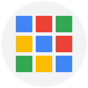

# Google Dock for Chrome

Your Google apps in a floating, macOS-style dock. Reveal it at the bottom of a webpage, switch between apps and keep your favorites close at hand.

## Install

1. Download **google-dock-for-chrome-1.0.0.zip** from the [latest release](https://github.com/lophas/google-dock-for-chrome/releases/latest) and extract it.
2. Open `chrome://extensions` and turn on **Developer mode**.
3. Click **Load unpacked** and select the extracted folder containing `manifest.json`.
4. Refresh your open website tabs. Pin the extension to Chrome’s toolbar for quick access to the app menu.

## Use the dock

Move the pointer to the **bottom center** of a webpage and pause briefly to reveal the dock. It hides when you move away.

| Action | What it does |
| --- | --- |
| Click an app | Switch to its existing tab, or open it if needed |
| Ctrl/Cmd/Shift-click | Open a new tab |
| Middle-click | Open a new background tab |
| Right-click → **Keep in Dock** | Pin or unpin the app |
| Right-click → **Open / Close** | Open the app or close one of its tabs |
| Drag a pinned icon | Change the dock order |
| Click the grid button | Search all apps and add favorites |
| **Alt+Shift+G** | Show or hide the dock |
| **Escape** | Dismiss the context menu or dock |

A dot marks a running app; a blue highlight marks the active app. Unpinned running apps appear to the right of the favorites and disappear when their last tab closes.

App tabs are collected in a **Google Dock** Chrome tab group, in the same order as the dock icons. The dock and app menu share their state across tabs. Opening an app closes the app menu.

## Available apps

Gmail, Calendar, Drive, Docs, Sheets, Slides, Meet, Chat, Keep, Photos, Maps, YouTube and Gemini, plus shortcuts to Payments, Password Manager, Google Account, Contacts and Google One.

## Customize

Open **Settings** from the app menu or toolbar launcher to choose favorites, icon size, theme, autohide and tab reuse.

**Using the macOS Dock?** Increase **Activation zone height** to reveal Google Dock before reaching the screen’s bottom edge. The default is **24 px**.

Change the keyboard shortcut at `chrome://extensions/shortcuts`.

## Good to know

- On Chrome settings, browser error pages, the Chrome Web Store and the built-in PDF viewer, use the **toolbar launcher** instead of the webpage dock.
- The dock stays hidden during webpage fullscreen.
- New app tabs use your default Google account. An existing tab may belong to another account.
- To update, replace the extension files, click **Reload** at `chrome://extensions`, then refresh website tabs. Your settings are preserved.

Settings stay on your device. No analytics; no access to mailbox, calendar or password contents.

Independent project, not affiliated with Google. Licensed under [GPL-3.0](LICENSE).
